# GitOps Observability

A Kubernetes-based observability lab demonstrating metrics, centralized logging, and distributed tracing for a FastAPI application deployed through Kubernetes and Argo CD.

The application, Docker build, Kubernetes application manifests, and GitHub Actions workflow live in the companion repository: [MysticBaghel/gitops-app](https://github.com/MysticBaghel/gitops-app).

## Features

- Prometheus metrics collection using `kube-prometheus-stack`.
- Application metrics scraping through Kubernetes `ServiceMonitor`.
- Grafana dashboards with five application-focused panels.
- Custom Prometheus alert rules for application availability and HTTP error rate, with the error-rate alert verified through Inactive, Pending and Firing states.
- Centralized application log collection using Grafana Alloy and Loki.
- Log exploration and querying through Grafana Explore using LogQL.
- Distributed tracing using OpenTelemetry instrumentation and Jaeger.
- OTLP HTTP trace export from the FastAPI application.
- Separate repositories for application delivery and observability configuration.
- A `Makefile` that wraps the long `kubectl` and `helm` commands.

## Architecture

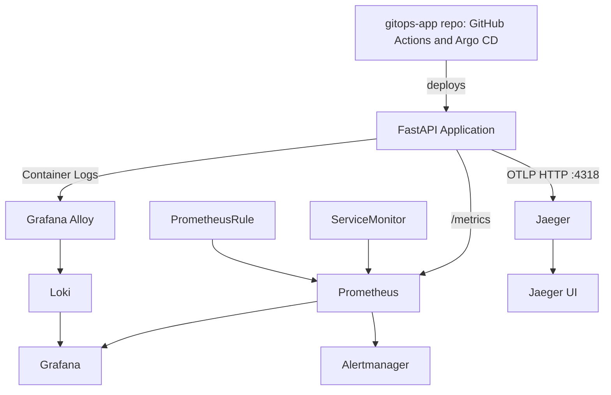

The application runs in namespace `gitops-demo`. The observability components run in namespace `monitoring`.

## Quick Start

This assumes the Minikube cluster, the application and the observability stack are already installed (see [Prerequisites](#prerequisites)). The `Makefile` needs GNU `make` (`sudo dnf install make` on Fedora).

```bash
make up        # start Minikube
make status    # check pods and Helm releases
make open      # port-forward Grafana, Prometheus and Jaeger in the background
make traffic   # send requests so metrics, logs and traces have data
make stop      # stop the port-forwards
```

After `make open`:

| UI | URL |
|---|---|
| Grafana | http://localhost:3000 |
| Prometheus | http://localhost:9090 |
| Jaeger | http://localhost:16686 |

Run `make` with no arguments to list every target.

## Screenshots

### Metrics: Prometheus and Grafana

The `GitOps Application Monitoring` dashboard. The HTTP Error Rate panel has data because test requests to a non-existent route were sent to generate 4xx responses.

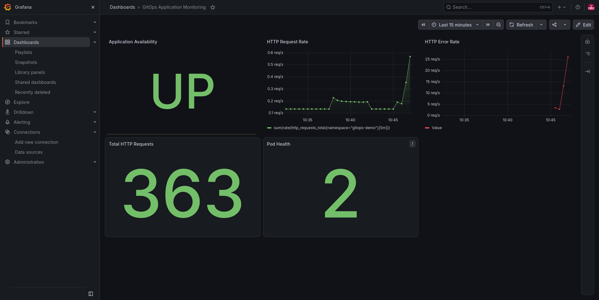

Both application pods are scraped through the `ServiceMonitor` (2/2 up).

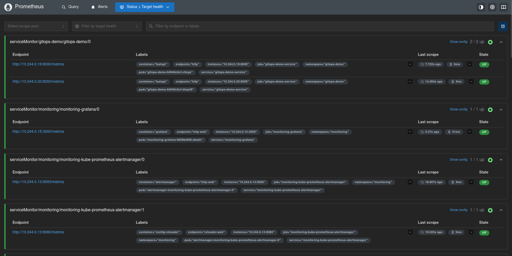

Both custom alert rules are loaded and evaluating.

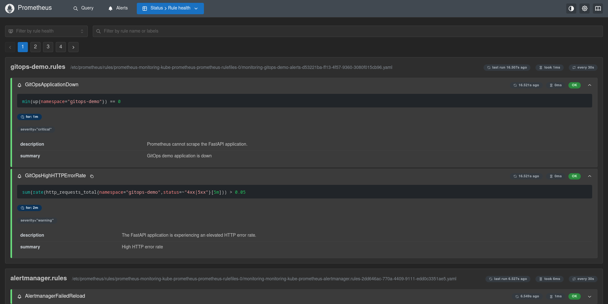

### Alert lifecycle

`GitOpsHighHTTPErrorRate` was exercised by sending 4xx traffic. See [Alerting](docs/alerting.md) for how to reproduce it.

| Inactive | Pending | Firing |
|---|---|---|
| 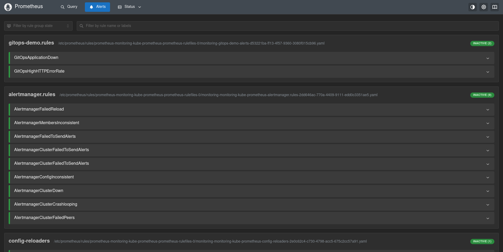 | 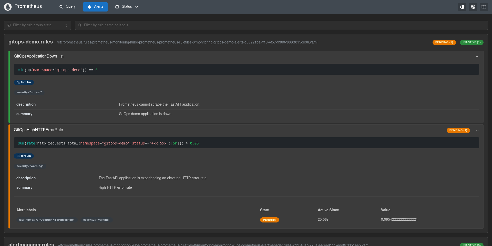 | 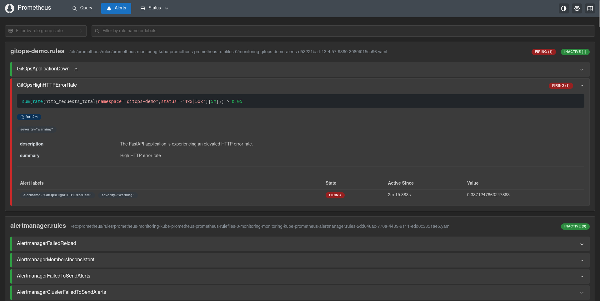 |

### Logging: Loki and Grafana Alloy

Grafana Explore with the query `{namespace="gitops-demo"}`. Most visible lines are Prometheus scraping `/metrics`.

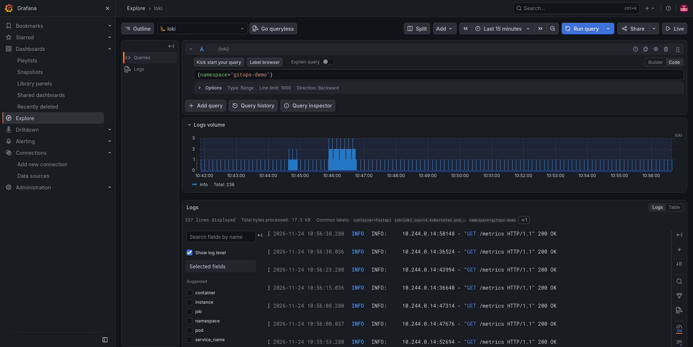

### Tracing: OpenTelemetry and Jaeger

Traces for service `gitops-demo`, and one trace opened to show its spans. The visible traces are `GET /metrics` requests from Prometheus scrapes.

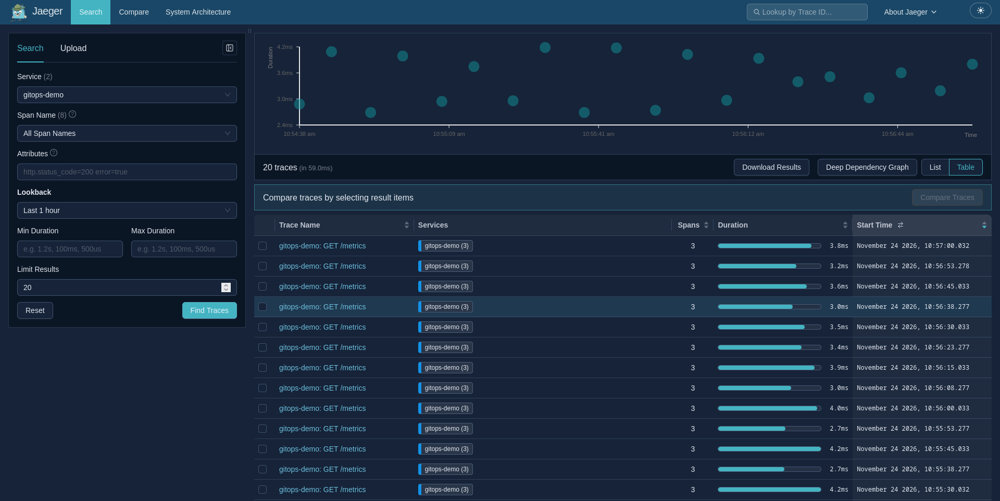

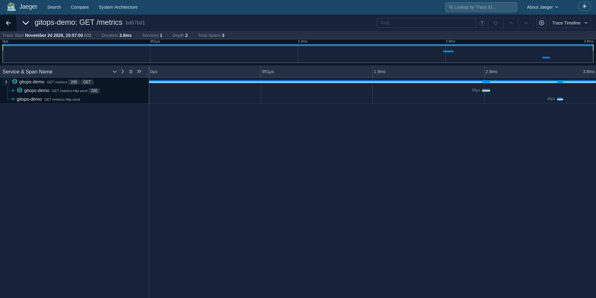

### GitOps and cluster

The application as managed by Argo CD (from the companion `gitops-app` repository): Healthy and Synced, with both pods running.

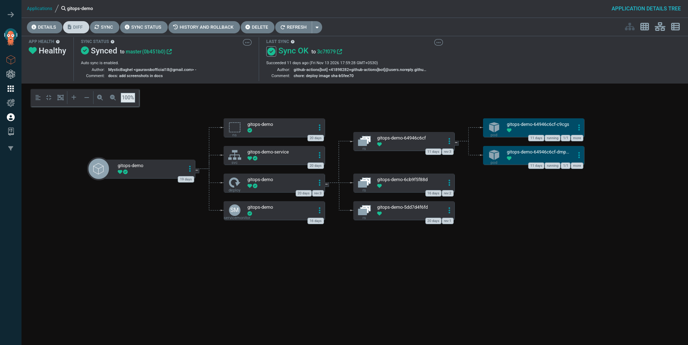

Cluster state from `make status`: all components running.

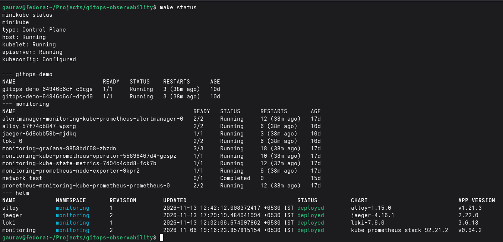

## Repository Layout

```text
gitops-observability/
├── Makefile
├── alerts/
│   └── app-alerts.yaml
├── docs/
│   ├── README.md
│   ├── architecture.md
│   ├── setup.md
│   └── alerting.md
├── monitoring/
│   ├── README.md
│   ├── kube-prometheus-stack/
│   ├── kube-prometheus-stack-92.21.2.tgz
│   └── values.yaml
├── logging/
│   ├── README.md
│   ├── alloy/
│   │   ├── values.yaml
│   │   └── config.alloy
│   ├── loki/
│   │   └── values.yaml
│   └── queries/
│       └── logql-queries.md
├── tracing/
│   ├── README.md
│   └── jaeger/
│       └── values.yaml
├── screenshots/
└── README.md
```

## Stack Responsibilities

| Component | Responsibility |
|---|---|
| Prometheus | Metrics collection, storage, querying and alert evaluation |
| Prometheus Operator | Manages Prometheus custom resources |
| ServiceMonitor | Configures application metrics scraping |
| PrometheusRule | Defines custom alert rules |
| Grafana | Metrics dashboards and log exploration |
| kube-state-metrics | Exposes Kubernetes object state |
| node-exporter | Exposes node-level metrics |
| Grafana Alloy | Collects Kubernetes container logs |
| Loki | Log aggregation and storage |
| OpenTelemetry | FastAPI application instrumentation |
| OTLP | Transports application traces |
| Jaeger | Trace collection, storage and visualization |

## Monitoring: Prometheus and Grafana

The `GitOps Application Monitoring` dashboard contains five application-focused panels:

1. **Application Availability**: whether application scrape targets are up.
2. **HTTP Request Rate**: request throughput over time.
3. **HTTP Error Rate**: rate of HTTP 4xx and 5xx responses. Shows "No data" until the application has returned at least one error response.
4. **Total HTTP Requests**: summed instrumented request counter.
5. **Pod Health**: number of ready application pods.

The total request counter may include Prometheus scrapes of `/metrics`; it should not be interpreted as end-user traffic only.

### Custom Alert Rules

Rules are defined in [`alerts/app-alerts.yaml`](alerts/app-alerts.yaml).

| Alert | Condition | Hold Duration | Severity |
|---|---|---:|---|
| `GitOpsApplicationDown` | `min(up{namespace="gitops-demo"}) == 0` | 1 minute | critical |
| `GitOpsHighHTTPErrorRate` | 5-minute 4xx/5xx rate exceeds `0.05` requests/second | 2 minutes | warning |

Prometheus selects the custom rules using the label `release: monitoring`.

**Current scope:** Both rules are discovered and evaluate successfully. `GitOpsHighHTTPErrorRate` has been taken through Inactive, Pending and Firing by sending test traffic. `GitOpsApplicationDown` has not been tested with a real outage. External notification delivery (email, Slack, etc.) is not configured. The application-down expression also needs an explicit absent-target check before production use, because `min()` over an empty vector returns no series.

## Logging: Loki and Grafana Alloy

Centralized logging collects application container logs from Kubernetes pods.

The logging pipeline:

```text
FastAPI Application
        |
        v
   Grafana Alloy
        |
        v
       Loki
        |
        v
     Grafana
   (Explore / LogQL)
```

- Alloy discovers Kubernetes pods belonging to `gitops-demo`.
- Pod, namespace and container labels are extracted.
- Logs are forwarded to Loki.
- Grafana Explore provides log querying through LogQL.

## Distributed Tracing: OpenTelemetry and Jaeger

Distributed tracing provides visibility into application request execution.

The tracing pipeline:

```text
FastAPI Application
        |
        v
 OpenTelemetry
 Instrumentation
        |
        v
    OTLP HTTP
        |
        v
      Jaeger
        |
        v
     Jaeger UI
```

- FastAPI is instrumented using OpenTelemetry.
- Traces are exported using OTLP over HTTP.
- Jaeger receives traces through port `4318`.
- The application is identified by the service name `gitops-demo`.
- Jaeger UI provides trace and span exploration.

**Storage limitation:** Jaeger currently uses in-memory storage. Trace data is ephemeral and can be lost when the Jaeger pod restarts.

## Prerequisites

- Kubernetes cluster and `kubectl`
- Helm 3
- Minikube or another Kubernetes environment
- GNU `make` (for the `Makefile` shortcuts)
- FastAPI application deployed in `gitops-demo`
- Application metrics exposed at `/metrics`
- Matching Kubernetes Service and `ServiceMonitor`
- Prometheus Operator and kube-prometheus-stack
- Grafana Alloy and Loki
- OpenTelemetry-instrumented application image and Jaeger

## Deployment and Operations

### Makefile targets

| Target | Does |
|---|---|
| `make up` | Start Minikube |
| `make status` | Show pods in `gitops-demo` and `monitoring`, plus Helm releases |
| `make open` | Start background port-forwards for Grafana, Prometheus and Jaeger |
| `make stop` | Stop those port-forwards |
| `make traffic` | Send 20 requests to `/` and `/health` |
| `make alerts` | Apply the custom alert rules |
| `make logs-app` | Tail the FastAPI application logs |
| `make logs-alloy` | Show recent Alloy logs |
| `make install` | Install the whole stack with Helm on a fresh cluster |

`make install` is only for a fresh cluster. The Prometheus stack must be installed as Helm release **`monitoring`**, because the alert rules select `release: monitoring` and the service names below derive from it.

### Equivalent raw commands

Apply custom alert rules from the repository root:

```bash
kubectl apply -f alerts/app-alerts.yaml
kubectl get prometheusrule -n monitoring
```

Check the deployed observability components:

```bash
kubectl get pods -n monitoring
kubectl get svc -n monitoring
helm list -n monitoring
```

## Local Access

`make open` starts all three port-forwards. To run one manually:

### Prometheus

```bash
kubectl port-forward -n monitoring \
  svc/monitoring-kube-prometheus-prometheus 9090:9090
```

Open: [http://localhost:9090](http://localhost:9090)

### Grafana

```bash
kubectl port-forward -n monitoring \
  svc/monitoring-grafana 3000:80
```

Open: [http://localhost:3000](http://localhost:3000)

The lab admin credentials are set in `monitoring/values.yaml`. They are for local use only and must not be reused anywhere else.

### Jaeger

```bash
kubectl port-forward -n monitoring \
  svc/jaeger 16686:16686
```

Open: [http://localhost:16686](http://localhost:16686)

Keep each port-forward process running while using its respective browser UI.

## Documentation

Detailed setup and implementation guides:

- [Documentation Index](docs/README.md)
- [Architecture](docs/architecture.md)
- [Setup and Operations](docs/setup.md)
- [Alerting](docs/alerting.md)
- [Monitoring](monitoring/README.md)
- [Centralized Logging](logging/README.md)
- [Distributed Tracing](tracing/README.md)

## Status and Limitations

This project demonstrates the three pillars of observability:

- **Metrics:** Prometheus and Grafana.
- **Logs:** Grafana Alloy and Loki.
- **Traces:** OpenTelemetry and Jaeger.

The lab runs in a local Minikube learning and demonstration environment. It is not a production-ready observability platform.

External notification routing, production-grade storage and retention, authentication hardening, backup and restore, and production resource sizing require additional design and validation.
