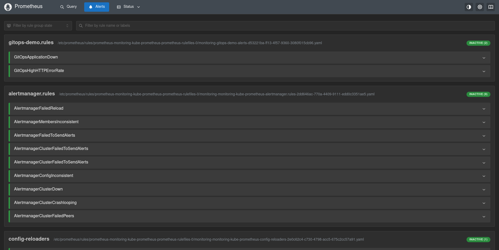
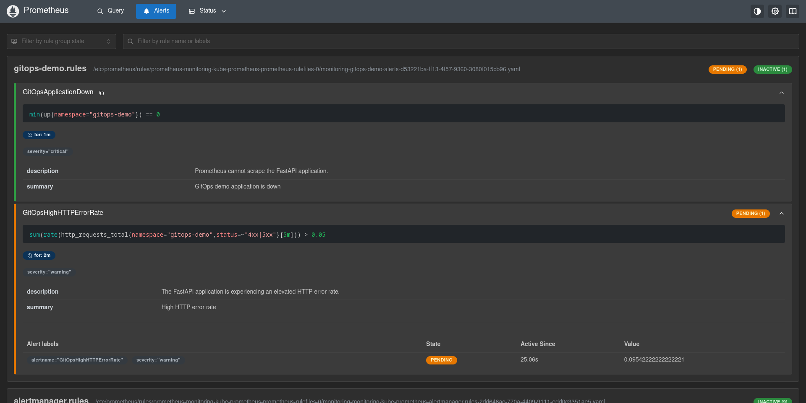
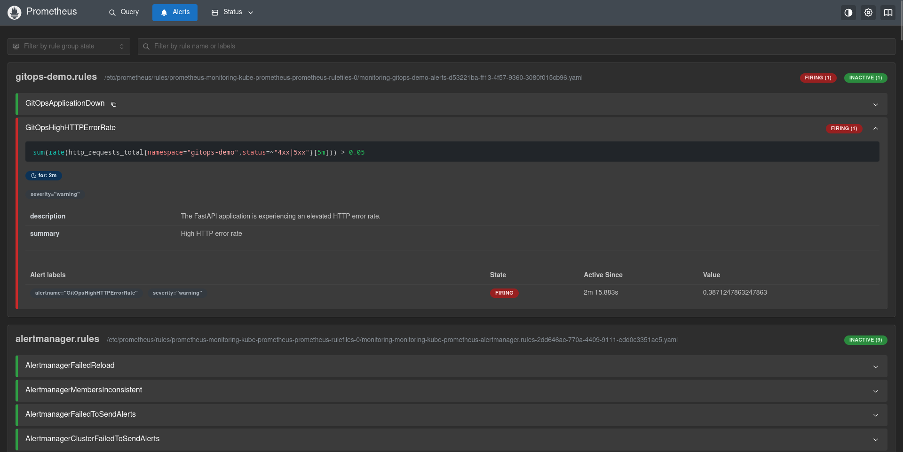

# Alerting

## Current rules

Custom rules are defined in `alerts/app-alerts.yaml` as a Kubernetes `PrometheusRule`.

- Resource: `gitops-demo-alerts`
- Namespace: `monitoring`
- Selection label: `release: monitoring`
- Rule group: `gitops-demo.rules`

Prometheus is configured to discover rules across namespaces and select rules with the `release: monitoring` label.

## GitOpsApplicationDown

```promql
min(up{namespace="gitops-demo"}) == 0
```

- Hold duration: `1m`
- Severity: `critical`

This expression fires when at least one matching scrape target reports `up == 0`.

**Known limitation:** if all matching series disappear entirely, `min()` over an empty vector returns no series, not zero. Add and test an explicit `absent()` or `absent_over_time()` condition before treating this as a production-grade outage alert.

## GitOpsHighHTTPErrorRate

```promql
sum(rate(http_requests_total{namespace="gitops-demo",status=~"4xx|5xx"}[5m])) > 0.05
```

- Hold duration: `2m`
- Severity: `warning`

The threshold is greater than `0.05` errors per second over a five-minute rate window. This is a lab threshold, not a universal production SLO. Tune it to expected traffic and acceptable error budgets.

## Apply and verify

```bash
kubectl apply -f alerts/app-alerts.yaml
kubectl get prometheusrule gitops-demo-alerts -n monitoring
```

Open `http://localhost:9090/rules` and find `gitops-demo.rules`.

- **OK:** the expression evaluated successfully.
- **Pending:** the condition is true but the `for` duration has not elapsed.
- **Firing:** the condition remained true for the configured duration.
- **Error:** Prometheus could not evaluate the rule successfully.

Current alert states appear at `http://localhost:9090/alerts`.

## Verified alert lifecycle

`GitOpsHighHTTPErrorRate` was exercised end to end by sending requests to a route that does not exist, which produces 4xx responses. The three states below were captured in the Prometheus `/alerts` page.

**Inactive:** no condition is true.



**Pending:** the condition is true (value about 0.095 errors/s, above the 0.05 threshold) but the 2 minute hold has not elapsed.



**Firing:** the condition stayed true for the hold duration (value about 0.387 errors/s).



### Reproduce the test

```bash
kubectl port-forward -n gitops-demo deployment/gitops-demo 8000:8000 >/dev/null 2>&1 &
sleep 3
for i in $(seq 1 100); do curl -s localhost:8000/doesnotexist >/dev/null; sleep 0.5; done
kill %1
```

Watch `http://localhost:9090/alerts`. The alert should reach Pending within about a minute and Firing about two minutes later. It returns to Inactive on its own after the five minute rate window passes without new errors.

This test does not exercise `GitOpsApplicationDown`, which needs a pod outage (see below).

## Testing considerations

The application Deployment is managed by Argo CD in the companion application repository. If automated sync/self-heal is enabled, manually scaling the Deployment may be reverted to the Git-declared replica count.

Use a dedicated test environment or coordinate the desired replica count with the GitOps source of truth for controlled outage testing. Restore the intended replica count and verify the alert returns to inactive.

## Notifications are not configured

Prometheus rule evaluation does not itself deliver messages to a person. Notification delivery requires Alertmanager routing and a receiver configuration (for example, email or Slack). That configuration is outside the current implemented scope.

Do not claim email/Slack notifications are working until a receiver is configured and an end-to-end notification test succeeds.
