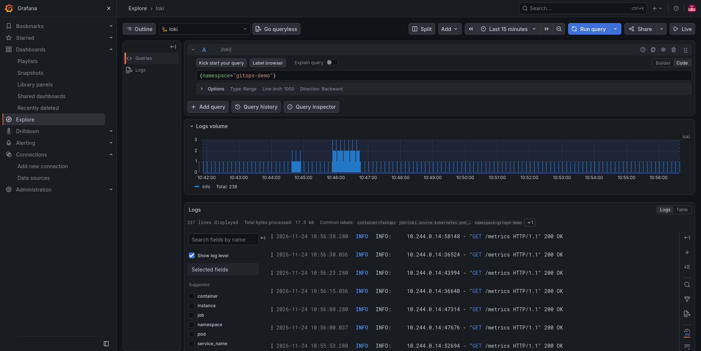

# Centralized Logging

## Overview

This component of the Kubernetes-based GitOps Observability Lab implements centralized logging using Grafana Loki and Grafana Alloy.

The objective is to collect application logs from Kubernetes pods, forward them to Loki, and visualize and query them through Grafana.

## Architecture

```text
FastAPI Application
 (2 Kubernetes Replicas)
         |
         v
  Grafana Alloy
 (Log Collection)
         |
         v
       Loki
  (Log Storage)
         |
         v
      Grafana
  (Explore / LogQL)
```

## Technology Stack

| Component | Purpose |
|---|---|
| Grafana Loki | Log aggregation and storage |
| Grafana Alloy | Kubernetes log collection |
| Grafana | Log visualization and exploration |
| Helm | Deployment and configuration |
| Kubernetes | Container orchestration |
| Minikube | Local Kubernetes environment |

## Deployment Details

| Component | Helm Release | Namespace | Version |
|---|---|---|---|
| Loki | loki | monitoring | Chart 7.6.0 |
| Alloy | alloy | monitoring | Chart 1.15.0 |

Loki runs in SingleBinary mode with one StatefulSet replica.

Alloy runs as a Deployment with one replica.

## Directory Structure

```text
logging/
├── README.md
├── loki/
│   └── values.yaml
├── alloy/
│   ├── values.yaml
│   └── config.alloy
└── queries/
    └── logql-queries.md
```

## 1. Loki Deployment

Loki is deployed using the official Grafana Helm chart.

The configuration uses:
- SingleBinary deployment mode
- Filesystem storage
- TSDB index store
- Schema v13
- One replica

### Install Loki

```bash
helm repo add grafana https://grafana.github.io/helm-charts
helm repo update

helm upgrade --install loki grafana/loki \
  --version 7.6.0 \
  --namespace monitoring \
  --create-namespace \
  -f logging/loki/values.yaml \
  --wait --timeout 5m
```

### Verify Loki

```bash
kubectl get pods -n monitoring | grep loki
kubectl get svc -n monitoring | grep loki
kubectl get pvc -n monitoring
```

## 2. Grafana Alloy Deployment

Grafana Alloy discovers Kubernetes pods, collects container logs and forwards them to Loki.

The collection configuration:
- Uses Kubernetes pod discovery.
- Filters pods belonging to `gitops-demo`.
- Extracts namespace, pod and container labels.
- Sends logs to Loki through its Kubernetes service endpoint.

### Install Alloy

```bash
helm upgrade --install alloy grafana/alloy \
  --version 1.15.0 \
  --namespace monitoring \
  -f logging/alloy/values.yaml \
  --wait --timeout 5m
```

### Verify Alloy

```bash
kubectl get pods -n monitoring | grep alloy

kubectl logs deployment/alloy \
  -n monitoring --tail=80
```

## 3. Grafana Loki Datasource

Add Loki as a datasource in Grafana.

Configuration:

| Setting | Value |
|---|---|
| Name | Loki |
| URL | `http://loki.monitoring.svc.cluster.local:3100` |
| Access | Server |

Navigate to:

Connections → Data Sources → Add Data Source → Loki

Save and test the connection.

## 4. Verify Log Collection

Check Loki readiness:

```bash
kubectl port-forward -n monitoring svc/loki 3100:3100
```

In another terminal:

```bash
curl http://localhost:3100/ready
```

Expected response:

```text
ready
```

Check available labels:

```bash
curl -G -s \
  http://localhost:3100/loki/api/v1/labels | jq
```

Query application logs:

```bash
curl -G -s \
  http://localhost:3100/loki/api/v1/query_range \
  --data-urlencode 'query={namespace="gitops-demo"}' \
  --data-urlencode 'limit=20' | jq
```

## 5. Grafana Explore

Open Grafana:

```text
http://localhost:3000
```

Navigate to Explore, select Loki, and execute:

```logql
{namespace="gitops-demo"}
```

Additional queries are available in [LogQL Queries](queries/logql-queries.md).

## 6. Verification Results

The logging pipeline was successfully verified.

- Loki readiness endpoint returned `ready`.
- Loki exposed Kubernetes log labels.
- Alloy discovered both FastAPI replicas.
- Logs were successfully forwarded to Loki.
- Loki API returned log streams from both replicas.
- Grafana Explore displayed application logs.
- HTTP GET `/metrics` requests with HTTP 200 responses were visible.

### Evidence

Grafana Explore with the Loki datasource, query `{namespace="gitops-demo"}`, last 15 minutes. Most visible lines are Prometheus scraping `/metrics` every few seconds, because that is the steady background traffic. Run `make traffic` to add requests to `/` and `/health`.



## 7. Troubleshooting

### Loki shows no data

Check Alloy:

```bash
kubectl logs deployment/alloy -n monitoring --tail=100
```

Check Loki:

```bash
kubectl get pods -n monitoring | grep loki
```

### Loki readiness failure

```bash
kubectl describe pod -n monitoring -l app.kubernetes.io/name=loki
```

### Check Helm releases

```bash
helm list -n monitoring
```